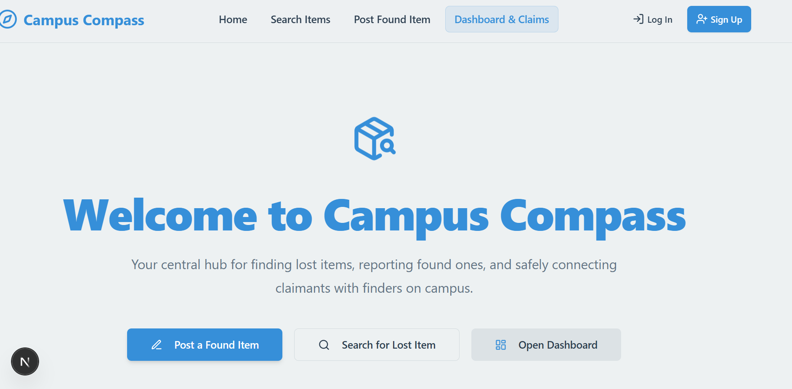
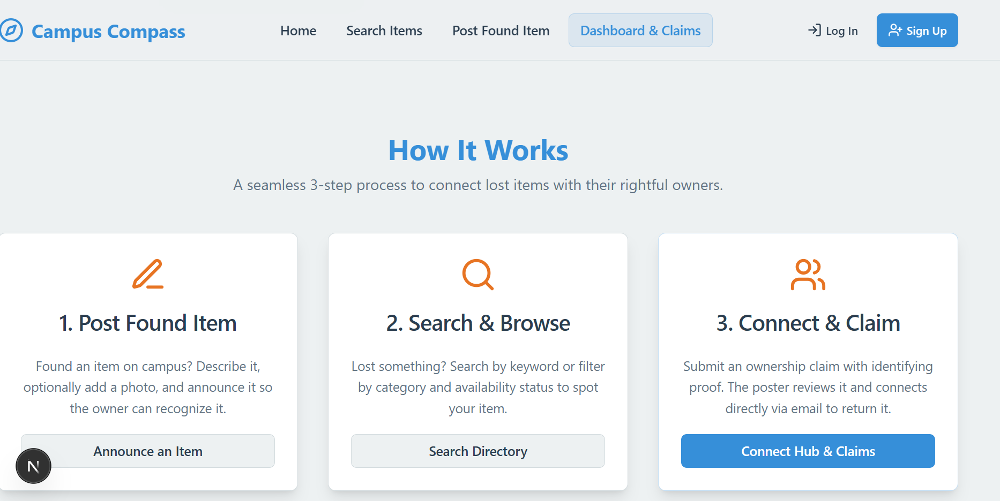
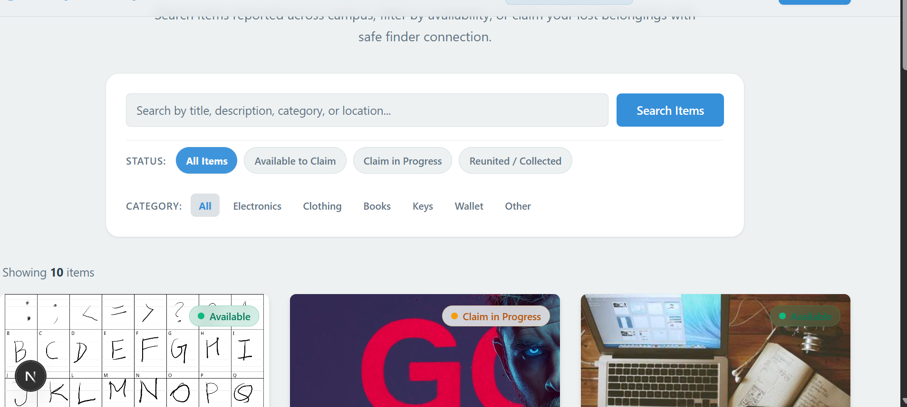
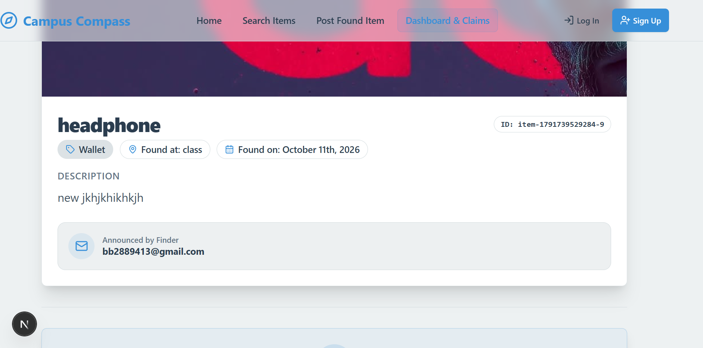
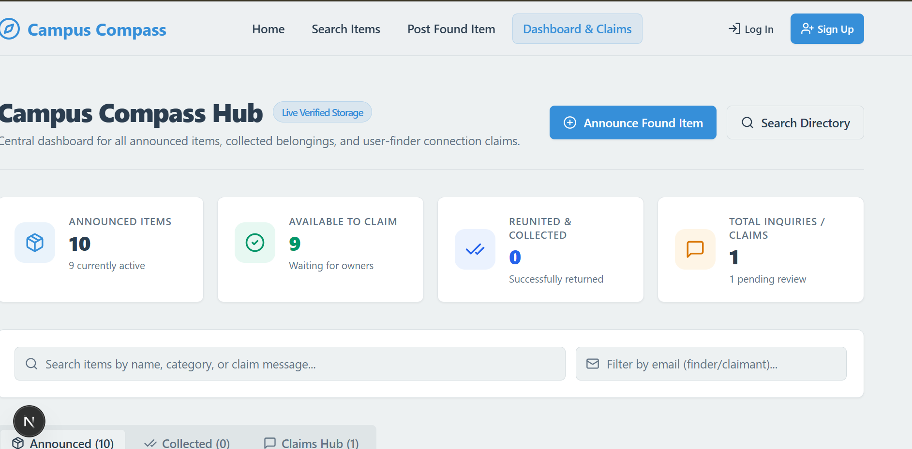

# 🧭 Campus Compass — Campus Lost & Found Hub

<div align="center">

[](https://nextjs.org/)
[](https://www.typescriptlang.org/)
[](https://tailwindcss.com/)
[](https://turbo.build/)
[](LICENSE)

**A modern, full-stack Lost & Found platform for university campuses.**  
Announce found belongings, search directory with real-time filters, and verify ownership claims through a secure verification lifecycle.

[Explore Search](#-search-directory--filters) • [Dashboard & Claims](#-claims-hub--dashboard) • [Quickstart](#-quickstart-guide) • [Database Architecture](#-database-architecture) • [AWS Deployment](#-deploying-on-aws)

<br/>



</div>

---

## 📖 Table of Contents
- [✨ Key Features](#-key-features)
- [📸 Visual Tour & Screenshots](#-visual-tour--screenshots)
- [💾 Database Architecture](#-database-architecture)
- [☁️ Deploying on AWS](#-deploying-on-aws)
- [🚀 Quickstart Guide (Local Setup)](#-quickstart-guide)
- [👥 Pre-Configured Test Accounts](#-pre-configured-test-accounts)
- [🛡️ Anti-Fraud & Verification Rules](#-anti-fraud--verification-rules)
- [🛠️ Tech Stack](#-tech-stack)
- [📄 License](#-license)

---

## ✨ Key Features

* 🌍 **Public Browsing Without Forcible Login**:
  * Anyone can browse the directory, search lost belongings, and view details openly.
  * Authentication is required only when taking sensitive actions (uploading an item, filing a claim, or approving a reunion).
* 🔄 **Automated Item Lifecycle**:
  * **Available** (🟢): Automatically set when an item is posted.
  * **Claim in Progress** (🟡): Automatically transitions when a claimant submits ownership proof.
  * **Reunited & Collected** (🔵): Automatically closed when the finder verifies and approves the claim.
* 🛡️ **Fraud & Duplicate Prevention**:
  * Users cannot claim items they announced themselves.
  * Users are barred from spamming multiple active claims on the same listing.
  * Only the original finder can approve/reject claims for their listing.
* ⚡ **Personalized Claims & Listings Hub**:
  * Direct separation between **Incoming Claims** (items you found) and **My Outgoing Claims** (items you lost and claimed).
  * Direct one-click mailto communication with claimant/finder.
* 📦 **Self-Contained Persistent Database**:
  * Fully functional zero-dependency JSON document storage engine.
  * Works out of the box with zero external database configuration.

---

## 📸 Visual Tour & Screenshots

### 1. Welcome & How It Works
Clear 3-step lifecycle guiding students to report, search, and safely reunite belongings:
<div align="center">
  
</div>

---

### 2. Search Directory & Category Filters
Filter instantly across categories (Electronics, Clothing, Books, Keys, Wallet, etc.) and availability status:
<div align="center">
  
</div>

---

### 3. Detailed Item Page & Ownership Claim Form
Contextual claim form pre-populates authenticated student info while preventing self-claims on own uploads:
<div align="center">
  
</div>

---

### 4. Interactive Dashboard & Claims Verification Center
Review incoming claims, examine ownership proof notes, contact claimants, and mark items returned:
<div align="center">
  
</div>

---

## 💾 Database Architecture

### Which Type of Database is Used?
Campus Compass uses a **Self-Contained Persistent JSON Document Database Engine** (`src/lib/mock-data.ts`):
* `lost-found-items.db.json`: Stores all announced items, timestamps, image data, and lifecycle status.
* `claims.db.json`: Stores all ownership claims, claimant notes, verification statuses, and timestamps.
* `users.db.json`: Stores user profiles and salted password hashes for session authentication.

### Why was this chosen for the project?
1. **Zero External Dependencies**: Anyone who clones this repository can run `npm install && npm run dev` immediately without having to install MongoDB, run Docker, setup PostgreSQL, or create third-party cloud accounts.
2. **Auto-Initialization**: If the DB files do not exist, the app automatically initializes them with pre-seeded sample data on first launch.
3. **True Local Persistence**: Unlike temporary in-memory arrays, every upload, status update, and claim persists across server restarts and page refreshes.

---

## ☁️ Deploying on AWS

If you want to host Campus Compass on Amazon Web Services (AWS), you have three production deployment paths:

### Option 1: AWS App Runner / AWS Elastic Beanstalk (Recommended for Fast Deployment)
1. **Containerize or Upload Code**:
   Build the Next.js app using the included build configuration:
   ```bash
   npm run build
   ```
2. **Configure Node.js Runtime**:
   Set `PORT=9002` (or `PORT=3000`) and the start command:
   ```bash
   npm run start
   ```
3. **Data Persistence**:
   For multi-container scaling, attach an **AWS Elastic File System (EFS)** mount to preserve the database JSON files across container redeployments.

### Option 2: AWS EC2 (Virtual Machine)
1. Launch an **Ubuntu 22.04 LTS / Amazon Linux 2023** EC2 instance (`t3.small` or `t3.medium`).
2. SSH into your instance and install Node.js 20 & Git:
   ```bash
   curl -fsSL https://deb.nodesource.com/setup_20.x | sudo -E bash -
   sudo apt-get install -y nodejs git
   ```
3. Clone and install:
   ```bash
   git clone https://github.com/0902kishan/Campus-Compass.git
   cd Campus-Compass
   npm install
   npm run build
   ```
4. Run in production with **PM2**:
   ```bash
   sudo npm install -g pm2
   pm2 start npm --name "campus-compass" -- start -- -p 9002
   pm2 save
   pm2 startup
   ```

### Option 3: Connecting to Cloud Databases on AWS (Enterprise Scaling)
To scale to thousands of simultaneous campus users, you can connect AWS cloud databases with zero UI disruption:
* **AWS DynamoDB**: Update the data layer in `src/lib/mock-data.ts` to query AWS DynamoDB using `@aws-sdk/client-dynamodb`.
* **AWS RDS (PostgreSQL/MySQL)**: Replace `mock-data.ts` with **Prisma ORM** pointed at your AWS RDS database URL.
* **AWS S3**: Point the image uploader in `ItemForm.tsx` to store uploaded item images directly in an **S3 Bucket** rather than Base64 strings.

---

## 🚀 Quickstart Guide

### 1. Clone the Repository
```bash
git clone https://github.com/0902kishan/Campus-Compass.git
cd Campus-Compass
```

### 2. Install Dependencies
```bash
npm install
```

### 3. Run Development Server
```bash
npm run dev
```

Open [http://localhost:9002](http://localhost:9002) in your browser.

---

## 👥 Pre-Configured Test Accounts

For fast review and demonstration, sample accounts are pre-seeded in the database:

| Role | Email | Password | What You Can Test |
| :--- | :--- | :--- | :--- |
| **Finder / Poster** | `finder1@example.com` | `password123` | Has active listings; can approve/reject claims |
| **Student / Claimant** | `student@campus.edu` | `password123` | Can claim items and track verification |

*(You can also use the one-click **"Quick Demo Accounts"** button on the Login page or register any new account).*

---

## 🛡️ Anti-Fraud & Verification Rules

1. **Own-Item Protection**:
   * A user who uploads a found item cannot claim that same item.
   * That same user **is free to claim any other item** found by someone else.
2. **Duplicate Claim Throttling**:
   * Claimants can only have one active claim per item at any given time.
3. **Strict Owner Permissions**:
   * Only the finder who announced the item has the authority to approve claims or delete the post.
4. **Automatic Reversion**:
   * If a claim is rejected and no other pending claims exist, the item automatically reverts to `available`.

---

## 🛠️ Tech Stack

* **Framework**: [Next.js 15 (App Router)](https://nextjs.org/)
* **Language**: [TypeScript](https://www.typescriptlang.org/)
* **Bundler**: Turbopack
* **Styling**: [Tailwind CSS](https://tailwindcss.com/) & [shadcn/ui](https://ui.shadcn.com/)
* **Forms & Validation**: [React Hook Form](https://react-hook-form.com/) + [Zod](https://zod.dev/)
* **Icons**: [Lucide React](https://lucide.dev/)
* **Authentication**: HTTP-Only Secure Cookies with React Context State

---

## 📄 License

This project is licensed under the [MIT License](LICENSE).
Feel free to use and adapt this project for your college or university!
